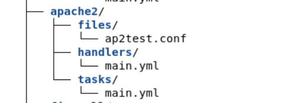
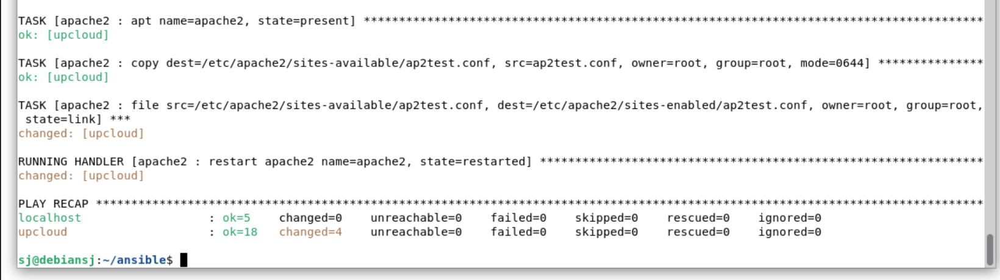
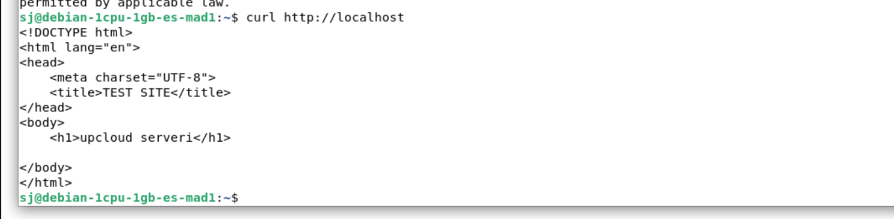
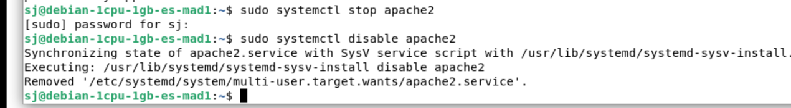
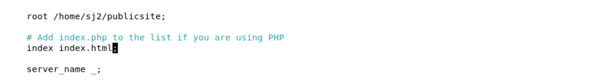
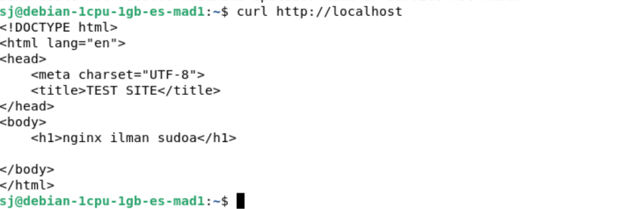
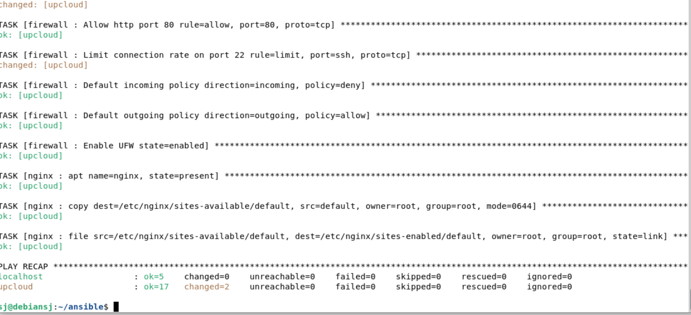
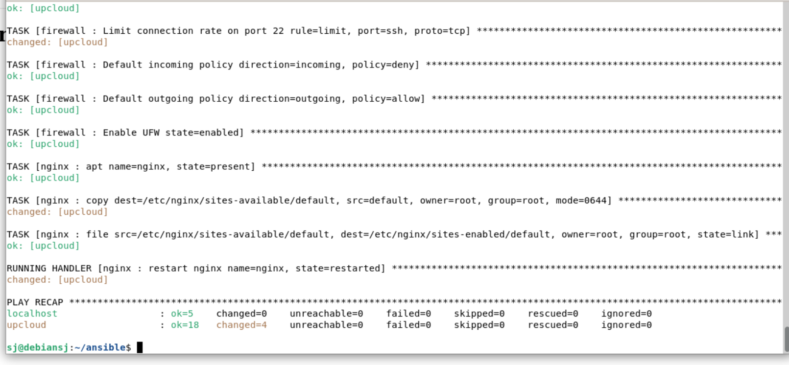

# Demoni

x)Tehtävän aloitus lähtee documentaatiota lukemalla ansible-docista ja handlereistä. 

Handlereitä voidaan käyttää ansiblella esim. Apache2 uudelleenkäynnistykseen, millä varmistetaan, että apache2 saa muutokset voimaan mitkä on nimetty "task" kohdassa playbookissa. 

Handlerit juoksee siinä järjestyksessä, missä ne on "handlers" otsikon alla.

Lähde:
https://docs.ansible.com/projects/ansible/latest/playbook_guide/playbooks_handlers.html


Ansible.builtin.service module:

"Controls services on remote hosts"

"enabled" - käynnistyy aina bootista

"name" - (pakollinen) servicen nimi

"state"- missä tilassa halutaan sen olla (started/stopped/reload/restart)

example : 

```yaml 
- name: Restart service httpd, in all cases
  ansible.builtin.service:
    name: httpd
    state: restarted
```

## apache2

apache on jo edellisen tehtävän toimesta koneella päällä.

Alkuun loin omalle upcloud palvelimelle uuden käyttäjän manuaalisti ja tein sinne käyttäjälle verkkosivuhakemiston mihin käyttäjällä on oikeudet muokata sivustoa ilman root/sudo oikeuksia.

Käyttämäni komennot:

```yaml
sudo adduser sj2
sudo mkdir -p /home/sj2/publicsite
sudo chown sj2:sj" /home/sj2/publicsite
```
Alimmainen komento lisää sj2 hakemiston omistajaksi. lähde: https://www.gnu.org/software/coreutils/manual/html_node/chown-invocation.html

Tämän jälkeen muokkasin ansiblen hakemistopuuta sen verran, että tein apachelle oman roolin, missä sillä on kolme alihakemisto "files", "handlers" ja "tasks"



## files ~/ap2test.conf

```yaml
#managed file, changes will be overwritten

<Virtualhost *:80>
        ServerName localhost
        DocumentRoot /home/sj2/publicsite


        <Directory /home/sj2/publicsite/>
                require all granted
        </Directory>
</VirtualHost>
```

## handlers ~/main.yml
```yaml
#Tämä ajetaan tasks tiedoston "notify" kohdassa.
- name: restart apache2
  systemd:
    name: apache2
    state: restarted
```

## tasks ~/main.yml
```yaml
- apt:
    name: apache2
    state: present

- copy:
    dest: /etc/apache2/sites-available/ap2test.conf
    src: ap2test.conf
    owner: root
    group: root
    mode: "0644"
  notify: restart apache2

- file:
    src: /etc/apache2/sites-available/ap2test.conf
    dest: /etc/apache2/sites-enabled/ap2test.conf
    owner: root
    group: root
    state: link
  notify: restart apache2

```
lähde: https://terokarvinen.com/apache-ansible/


TESTI KUVAT

Ansible playbookin ajaminen apache2 handlerillä ja katotaan vielä curlilla toimiiko

    


## NGINX

Alkuun laitettiin apache2 pois päältä




sudo systemctl stop apache2
sudo systemctl disable apache2 pysyy pois päältä

tämän jälkeen sudo apt install nginx

ja tämän jälkeen kävin muuttamassa nginx tiedostoa niin, että se löytää oman verkkosivuni



https://nginx.org/en/docs/http/request_processing.html

https://nginx.org/en/docs/beginners_guide.html

https://wiki.debian.org/Nginx/DirectoryStructure

https://www.redhat.com/en/blog/deploying-static-website-ansible

tämän jälkeen sama kuin apachella eli localhosti sivu auki ja muutokset näkyy siellä.



https://www.redhat.com/en/blog/deploying-static-website-ansible


## Ansible NGINX

Tämän hakeimston tein aikalailla saman kuin apachella, kävin vain kommentoimassa apache2 pois ja kävin myös upcloud palvelimella manuaalisesti laittamassa apachen pois päältä ennen playbookin ajamista nginxillä.

Ngix 

files/ ~default

```yaml
server {
    listen 80 default_server;
    server_name _;

    root /home/sj2/publicsite;
    index index.html;


    location / {
    try_files $uri $uri/ =404;
    }  
}
```
handlers/ ~main.yml

```yaml
- name: restart nginx
  systemd:
    name: nginx
    state: restarted  
```

tasks/ ~main.yml
```yaml
- apt:
    name: nginx
    state: present

- copy:
    dest: /etc/nginx/sites-available/default
    src: default
    owner: root
    group: root
    mode: "0644"
  notify: restart nginx

- file:
    src: /etc/nginx/sites-available/default
    dest: /etc/nginx/sites-enabled/default
    owner: root
    group: root
    state: link
  notify: restart nginx

```
Elikkä hyvin samankaltainen kuin apace2 ansible files sivua lukuunottamatta.

## Testikuvat







## lähteet

https://www.redhat.com/en/blog/deploying-static-website-ansible
https://nginx.org/en/docs/beginners_guide.html
https://terokarvinen.com/palvelinten-hallinta/
https://wiki.debian.org/Nginx/DirectoryStructure
https://docs.ansible.com/projects/ansible/latest/playbook_guide/playbooks_handlers.html
