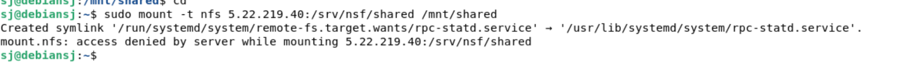
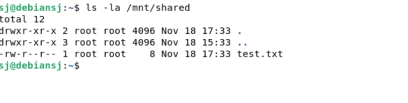
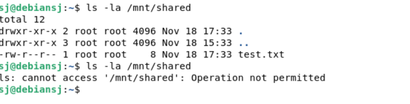
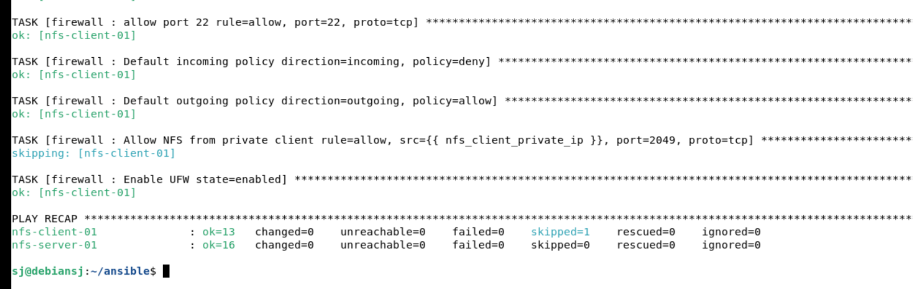
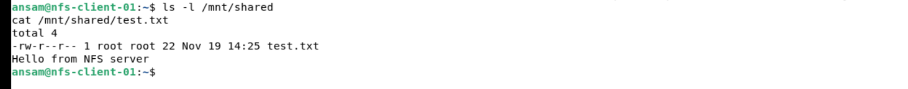

# Fantasia

Tämä tehtävä alkaa 17.11. klo 11:00

alkuun lukastaan terontarinoita hetki.

## Karvinen 2023: Configuration Management of Distributed Systems over Unreliable and Hostile Networks 

4.12.1 Size and Complexity of Some DSLs
- Salt 510 functions
- Puppet 113

4.12.2 Use of DSL Functions in Case Configuration

- Funktioiden käyttö keskittyy hyvin pieneen osaan kaikista funktiosta, mitkä saa suurimman osan töistä tehtyä.

4.12.3.1 Dependencies Between Main Functions
- Daemon setup package, file, service
- App setup package, file
- User management user, group
- File manipulation file, directory, symlink

  ## a) NFSv4 + Kerberos

  Tehtävän lähtökohtana oli käydä läpi NFS dokumentaatiota ja miten toteuttaa servereiden välinen suojaus kerberoksella. Tarkoituksena oli toteuttaa nfs kahdella UpCloud serverillä missä toinen serveri toimii puhtaasti NFS serverinä ja toinen toteuttaa Kerberoksen tiketöintiä. Ja Client koneena toimii debian VM.

  Nfs yhteyttä ei ole tavallisesti suojattu ja vaatii yhteyden suojaamiseen kaverikseen joko Tls suojauksen, kerberoksen tai vpn, kuten wireguard.

  lähde:https://wiki.archlinux.org/title/Kerberos

  NFS - install
  - Server paketti
  ```yaml
   $sudo apt-get install nfs-kernel-server #tuo tarvittavat hakemistot jakoa varten + yleensä myös tuo samat työkalut kuin nfs-common.
  ```
- Client paketti
  ```yaml
   $sudo apt-get install nfs-common #työkalut jaon käyttöön.
   ```

  Tässä vaiheessa tein asennus vaiheen molemmille koneille yhdelle UpCloud serverille ja myös omalle Debian VM:lle.
  - UpCloud serverin tiedostopolku mihin Client liitetään --> /srv/nfs/shared
  - Debian Client tiedostopolku /mnt/shared
  - Määritykset /etc/exports
  - /etc/fstab mount after boot presistent
 

  Nfs kautta jaettavat hakemistot on "exports" ja tiedosto johon lisätään jaettava hakemisto löytyy /etc/exports tai vaihtoehtoisesti /etc/exports.d

  lähde:https://wiki.debian.org/NFS/Server

  Tässä näkyy UpCloud serverin puolella, kun /etc/exports on vielä tyhjä

  

  Kävin tekemässä omat määritykset /etc/exports eli mikä tiedosto on jaossa, mikä osoite saa jaon ja millä oikeuksilla.

   ```yaml
    /srv/nfs/shared <ip>/32(rw,sync)
  ```
  Tämän jälkeen kokeilin mounttia debian VM:llä ja sieltä tuli "access denied". Tässä kohtaa en ole vielä päässyt johtopäätökseen mikä oli syynä, mutta nfs keskustelee clientin kanssa "network socketeilla" ja käyttää priviledged porttia mikä on alle 1024 numeron.

  

  Mikä vahvistaa tätä on se, että kun kokeilin laittaa "insecure" määrityksen /etc/export hakemistoon mikä poistaa priviledged port tarpeen niin tämän jälkeen tiedostojen vaihto onnistui, mutta uskon tähän olevan joku järkevämpi määritys ihan tietoturvan takia.

    

  Joka tapauksessa sain NFS toimimaan, mutta vaatii vielä uppoutumista enemmän. Seuraavaksi yritän toteuttaa tuon Kerberos serverin millä sitten saisi tietoturvaa paremmaksi.

  Tähän olen päässyt tässä vaiheessa, kun kello näyttää 19:52 18.11.


# NFS Ansible

tehtävä aloitettu 19.11 klo 8:00 

Lähdin totetuttamaan tätä kahdella UpCloud serverillä missä serverit pystyy keskustelemaan private networkissä, joten pääsen sillä nyt yli tuosta aikaisemmasta portti ongelmasta. 

## lähtökohta
- nfs-server-01 UpCloud (Debian 13)
- nfs-client-01 UpCloud (Debian 13)
- Control node Debian VM 13

Inventory file (host.ini) määrittelin ryhmät ja niiden alle hostit ip osoitteineen. Tässä käytin myös variablea jotta myöhemmin ei tarvi muistaa ip osoitteita vaan voin käyttää "{{ variable }}" tyyliä. 

```yaml
[nfs_servers]
nfs-server-01 ansible_host=5.22.219.40 

[nfs_clients]
nfs-client-01 ansible_host=5.22.217.121

[nfs_servers:vars]
nfs_client_private_ip=10.0.2.30

[nfs_clients:vars]
nfs_server_private_ip=10.0.2.20


[all:vars]
ansible_python_interpreter=/usr/bin/python3
```
Site.yml

```yaml
- name: ansam on both servers
  hosts: nfs_servers:nfs_clients
  become: true
  vars:
    ansible_user: root
  roles:
    - ansam

- name: configure nfs server
  hosts: nfs_servers
  become: true
  vars:
    ansible_user: ansam
  roles:
    - nfs
    - firewall

- name: configure nfs client
  hosts: nfs_clients
  become: true
  vars:
    ansible_user: ansam
  roles:
    - nfs_client
    - firewall
```

Playbookin rooleja on 4:
- ansam --> luo käyttäjän molemmille servereille, jolla salasanattomat sudo oikeudet.
- nfs --> asentaa tarvittavat paketit serverin puolelle (nfs-kernel-server), luo jaettavan hakemiston ja määrittää nfs jaon. sisältää myös Jinja2-templaten mikä luo /etc/exports sisällön.
- nfs_client --> asentaa tarvittavat työkalut (nfs-common) client serverille ja liittää client serverin hakemistoon nfs serverin jaettavan hakemiston.
- firewall --> asentaa ufw ja pistää sen päälle molempiin servereihin ja avaa tarvittavat portit SSH:lle ja NFS:lle.

## roolit

Ansam/main.yml

```yaml
- name: Create a group sudoless
  ansible.builtin.group:
    name: sudoless
    state: present

- name: Create user 
  ansible.builtin.user:
      name: ansam
      state: present
      groups: sudoless
      append: true
      shell: /bin/bash
      create_home: true

- name: SSH KEY
  ansible.posix.authorized_key:
      user: ansam
      state: present
      key: ssh-ed25519 AAAAC3NzaC1lZDI1NTE5AAAAICFwmxaesEHYVg043YIepGNfNaMZ304IxkHp2DhNv51a sj@debiansj

- name: passwordless sudo
  ansible.builtin.copy:
      dest: /etc/sudoers.d/sudoless
      content: "%sudoless ALL =(ALL:ALL) NOPASSWD: ALL\n"
      owner: root
      group: root
      mode: "0644"
```
NFS(defaults/handlers/tasks/templates)

default(path/clients/options) näitä arvoja käytetään myöhemmin Jinja2 for loopissa jota template moduuli taas myöhemmin käyttää tasks osiossa rakentaakseen /etc/export sisällön.
```yaml
nfs_exports:
  - path: /srv/nfs/shared
    clients: "{{ nfs_client_private_ip }}"
    options: "rw,sync,no_subtree_check,root_squash"
```
handler

```yaml
- name: reload nfs exports
  command:
    cmd: exportfs -ra #päivittää jaot
```
tasks

```yaml
- name: install nfs server
  apt:
    name: nfs-kernel-server
    state: present
    update_cache: true

- name: nfs shared exports
  file:
    path: "{{item.path}}" #default aikasemmasta
    state: directory
    owner: root
    group: root
    mode: "0755" #root rwx / muut rx
  loop: "{{nfs_exports}}" #default tiedoston looppi

- name: configure nfs exports
  template:
    src: exports.j2
    dest: /etc/exports
    owner: root
    group: root
    mode: "0644" #root rw / muut r
  notify: reload nfs exports

- name: enable and start nfs server
  systemd:
    name: nfs-kernel-server
    enabled: true
    state: started
```
templates

for looppi
```yaml

{{ export.path }} {{ export.clients }}({{ export.options }})


```
NFS_CLIENT/main.yml

```yaml
- name: install nfs client
  apt:
    name: nfs-common
    state: present

- name: mount nfs share
  mount:
    src: "{{ nfs_server_private_ip }}:/srv/nfs/shared"
    path: /mnt/shared
    fstype: nfs4
    opts: rw,hard
    state: mounted
```
Firewall

```yaml
- name: install ufw
  ansible.builtin.apt:
    name: ufw
    state: present

- name: allow port 22
  community.general.ufw:
    rule: allow
    port: "22"
    proto: tcp

- name: Default incoming policy
  community.general.ufw:
    direction: incoming
    policy: deny

- name: Default outgoing policy
  community.general.ufw:
    direction: outgoing
    policy: allow

- name: Allow NFS from private client
  community.general.ufw:
    rule: allow
    src: "{{ nfs_client_private_ip }}"
    port: "2049"
    proto: tcp
  when: "'nfs_servers' in group_names" #ajaa pelkästään serverin puolelle tämän. ei clientille.

- name: Enable UFW
  community.general.ufw:
    state: enabled
```

# idempotentti



# mount ok



    lähteet
    - https://packages.debian.org/trixie/nfs-common
    - https://packages.debian.org/trixie/nfs-kernel-server
    - https://wiki.debian.org/NFS/Server
    - https://web.mit.edu/kerberos/krb5-latest/doc/admin/conf_files/krb5_conf.html
    - https://debian-handbook.info/browse/vi-VN/stable/sect.nfs-file-server.html
    - https://docs.ansible.com/projects/ansible/latest/collections/ansible/posix/mount_module.html
    - https://upcloud.com/docs/guides/file-sharing-over-nfs-on-ubuntu/

