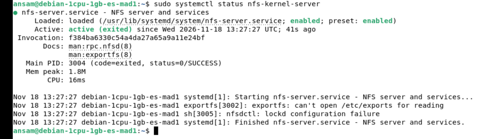

# Fantasia

Tämä tehtävä alkaa 17.11. klo 11:00

alkuun lukastaan terontarinoita hetki.

## Karvinen 2023: Configuration Management of Distributed Systems over Unreliable and Hostile Networks 

4.12.1 Size and Complexity of Some DSLs
- Salt 510 functions
- Puppet 113

4.12.2 Use of DSL Functions in Case Configuration

- Funktioiden käyttö keskittyy hyvin pieneen osaan kaikista funktiosta, mitkä saa suurimman osan töistä tehtyä.

4.12.3.1 Dependencies Between Main Functions
- Daemon setup package, file, service
- App setup package, file
- User management user, group
- File manipulation file, directory, symlink

  ## a) NFSv4 + Kerberos

  Tehtävän lähtökohtana oli käydä läpi NFS dokumentaatiota ja miten toteuttaa servereiden välinen suojaus kerberoksella. Tarkoituksena oli toteuttaa nfs kahdella UpCloud serverillä missä toinen serveri toimii puhtaasti NFS serverinä ja toinen toteuttaa Kerberoksen tiketöintiä. Ja Client koneena toimii debian VM.

  Nfs yhteyttä ei ole tavallisesti suojattu ja vaatii yhteyden suojaamiseen kaverikseen joko Tls suojauksen, kerberoksen tai vpn, kuten wireguard.

  lähde:https://wiki.archlinux.org/title/Kerberos

  NFS - install
  - Server paketti
  ```yaml
   $sudo apt-get install nfs-kernel-server #tuo tarvittavat hakemistot jakoa varten + yleensä myös tuo samat työkalut kuin nfs-common.
  ```
- Client paketti
  ```yaml
   $sudo apt-get install nfs-common #työkalut jaon käyttöön.
   ```

  Tässä vaiheessa tein asennus vaiheen molemmille koneille yhdelle UpCloud serverille ja myös omalle Debian VM:lle.
  - UpCloud serverin tiedostopolku mihin Client liitetään --> /srv/nfs/shared
  - Debian Client tiedostopolku /mnt/shared
  - Määritykset /etc/exports
  - /etc/fstab mount after boot presistent
 

  Nfs kautta jaettavat hakemistot on "exports" ja tiedosto johon lisätään jaettava hakemisto löytyy /etc/exports tai vaihtoehtoisesti /etc/exports.d

  lähde:https://wiki.debian.org/NFS/Server

  Tässä näkyy UpCloud serverin puolella, kun /etc/exports on vielä tyhjä

  

  Kävin tekemässä omat määritykset /etc/exports eli mikä tiedosto on jaossa, mikä osoite saa jaon ja millä oikeuksilla.

   ```yaml
    /srv/nfs/shared <ip>/32(rw,sync)
  ```
  Tämän jälkeen kokeilin mounttia debian VM:llä ja sieltä tuli "access denied". Tässä kohtaa en ole vielä päässyt johtopäätökseen mikä oli syynä, mutta nfs keskustelee clientin kanssa "network socketeilla" ja käyttää priviledged porttia mikä on alle 1024 numeron.

  

  Mikä vahvistaa tätä on se, että kun kokeilin laittaa "insecure" määrityksen /etc/export hakemistoon mikä poistaa priviledged port tarpeen niin tämän jälkeen tiedostojen vaihto onnistui, mutta uskon tähän olevan joku järkevämpi määritys ihan tietoturvan takia.

    

  Joka tapauksessa sain NFS toimimaan, mutta vaatii vielä uppoutumista enemmän. Seuraavaksi yritän toteuttaa tuon Kerberos serverin millä sitten saisi tietoturvaa paremmaksi.

  Tähän olen päässyt tässä vaiheessa, kun kello näyttää 19:52 18.11.

  Kerberos server pystyyn seuraavaksi ja tämän jälkeen automatisointi ansiblella.--> 


    lähteet
    - https://packages.debian.org/trixie/nfs-common
    - https://packages.debian.org/trixie/nfs-kernel-server
    - https://wiki.debian.org/NFS/Server
    - https://web.mit.edu/kerberos/krb5-latest/doc/admin/conf_files/krb5_conf.html
    - https://debian-handbook.info/browse/vi-VN/stable/sect.nfs-file-server.html
    - https://docs.ansible.com/projects/ansible/latest/collections/ansible/posix/mount_module.html
    - https://upcloud.com/docs/guides/file-sharing-over-nfs-on-ubuntu/

