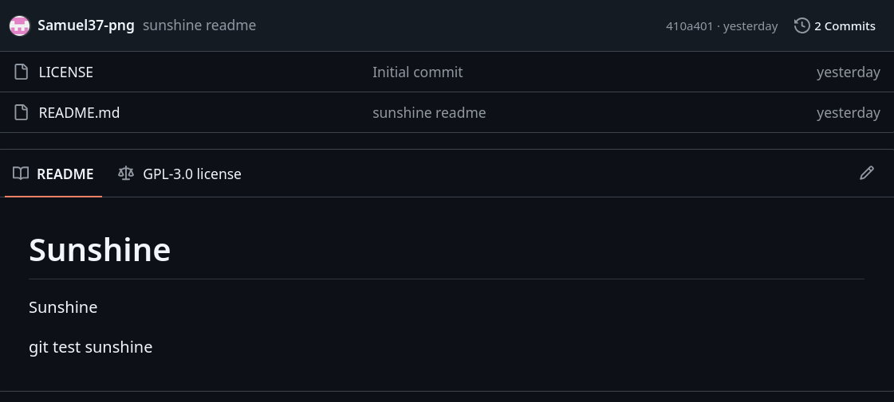
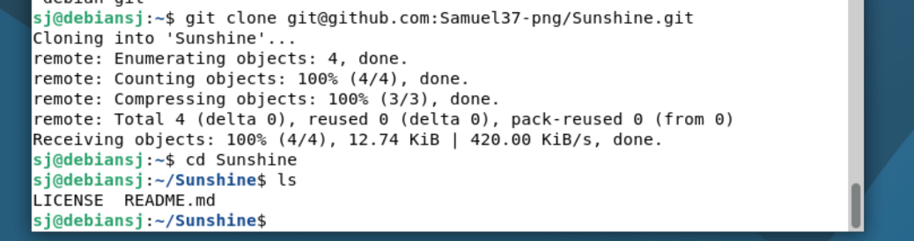
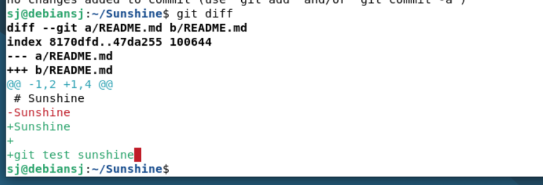
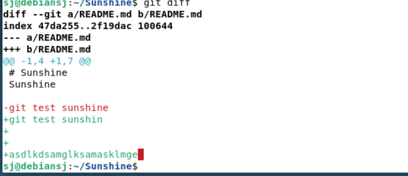
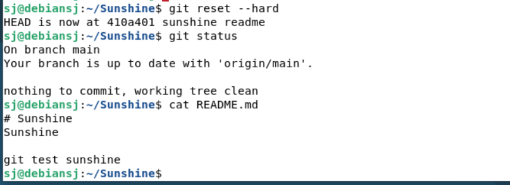
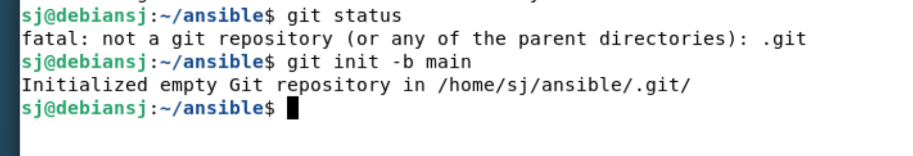
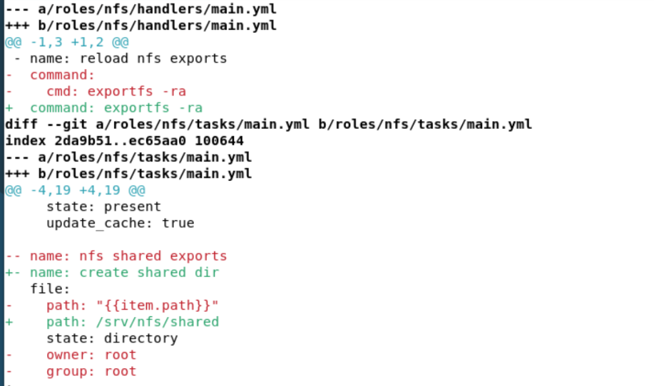
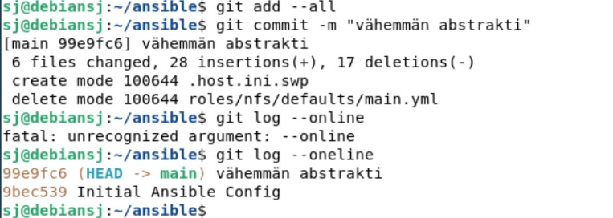
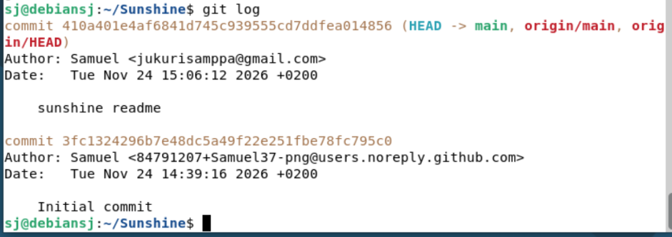

# Gitar Hero

## X)

Git komentoja muistiin:
```yaml
git init # Start new Repo
```
```yaml
git clone # clone existing repo
```
```yaml
git add --all # add all files
```
```yaml
git commit # commit changes
```
```yaml
git status # check what you have added
```
```yaml
git push # push the current branch to its tracking branch
```
```yaml
git pull # merge with your current branch
```
https://git-scm.com/cheat-sheet

What is git? 

Git on versionhallinta, joka tallentaa dataa "snapshotteina" eikä tiedostoina. Jos nykyiseen versioon ei ole tullut muutoksia ei uutta snapshottia oteta. Git lukee versionhallintaa pääasiassa paikallisesti mikä tekee siitä erittäin nopean ja mahdollistaa myös offline käytön.

## {a..e)

Tehtävä alkoi luomalla uusi repo ja testaamalla, että muutokset gitissä tulee myös weppiliittymäään. 

      

Klooni ja tehdyt muutokset.





Testiajo tehdään muutokset ja poistetaan ne.

  

Asensin Git:in ansible kansioon ja tein tiedostoihin muutokset ja sen jälkeen tarkastelin versionhallintaa.

```yaml
git init #tehdään varasto ansible
```



Muutokset ansibleen.



Ensimmäinen versio + tehdyt muutokset.




Tarkastellaan logia.




